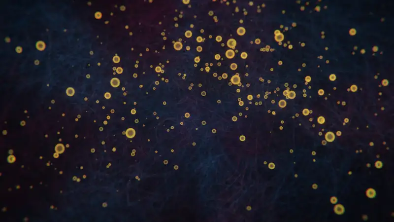
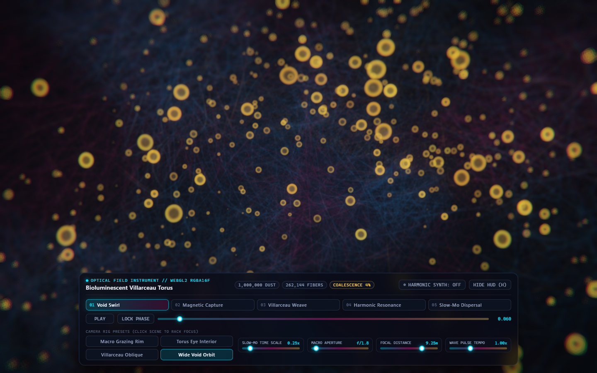
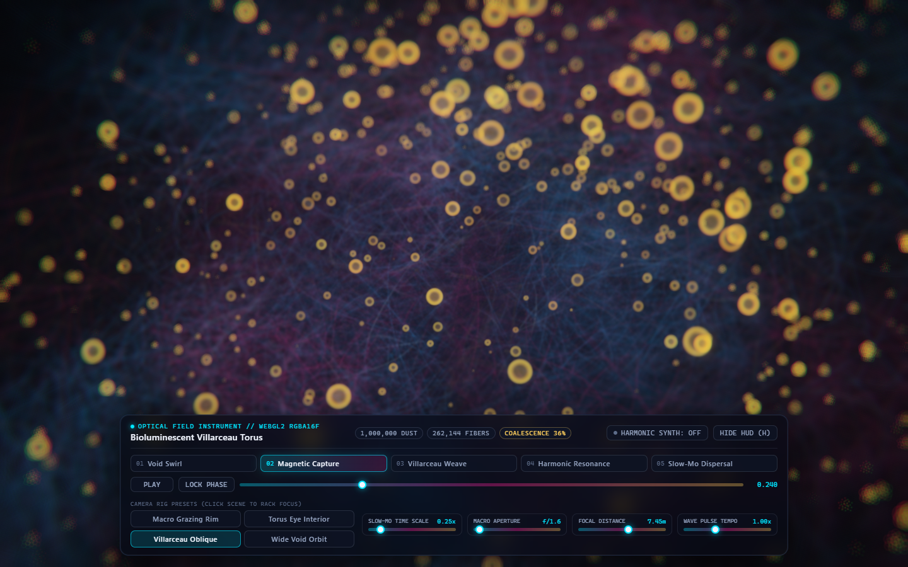
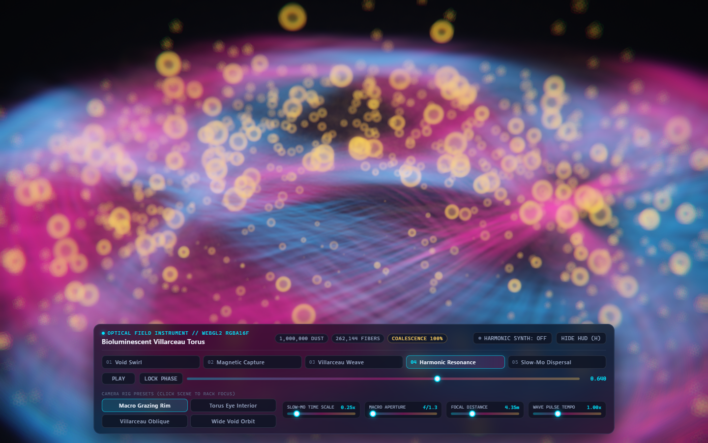
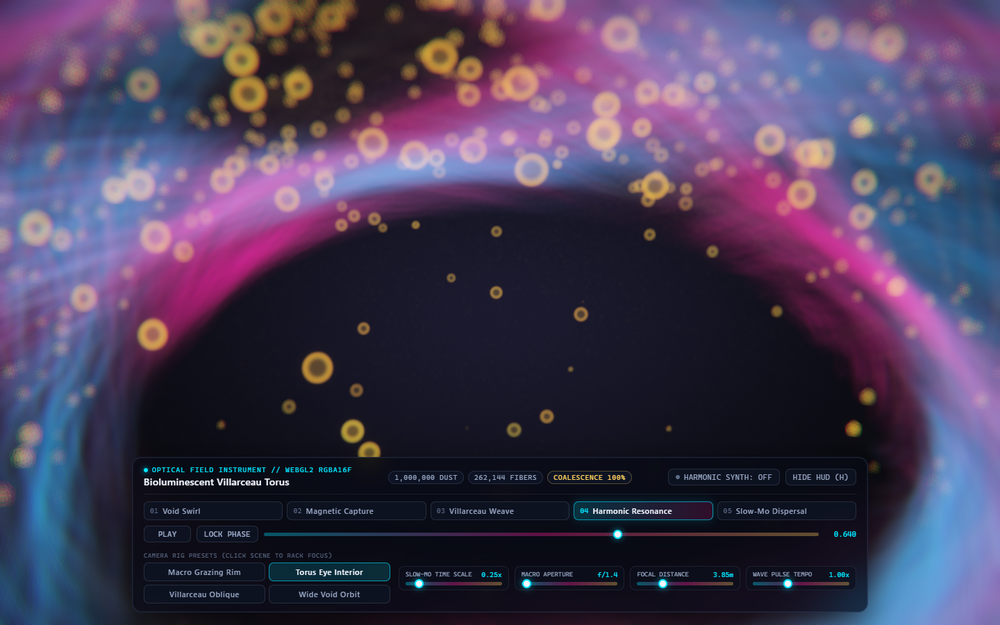
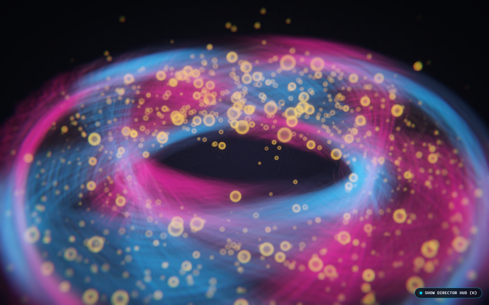

**[English](./README.md)** · **[简体中文](./README.zh-CN.md)** · **[日本語](./README.ja.md)** · **[한국어](./README.ko.md)**

# 생체발광 광섬유 토러스 (Bioluminescent Fiber-Optic Torus)

<p align="center">
  <a href="https://github.com/Emily2040/bioluminescent-torus/releases/download/v1.0.0/bioluminescent-torus-1080p60.mp4">
    
  </a>
</p>

<p align="center">
  <a href="https://github.com/Emily2040/bioluminescent-torus/releases/download/v1.0.0/bioluminescent-torus-1080p60.mp4">
    <strong>▶ Play / Download Full 1080p60 Video With Sound (사운드 포함 45초 1080p60 전체 영상 재생 및 다운로드)</strong>
  </a>
</p>

순수 WebGL2와 GLSL ES 3.0(`#version 300 es`)으로 구현한 실시간 3D 광학 시뮬레이션입니다. 칠흑 같은 허공 속을 소용돌이치는 `100만`(`1,000,000`) 개의 황금빛 더스트 입자와 `2,048` 가닥의 생체발광 광섬유 스트랜드(`262,144` 개의 카메라 지향 리본 세그먼트)가 일렉트릭 블루(`#00E5FF`)와 생체발광 마젠타(`#FF1493`)의 대향 진행파에 맞춰 맥동하며 정교한 3D 기하학적 토러스(원환체)로 응집되는 전 과정을 물리 매크로 보케 피사계 심도(Macro Bokeh DoF)와 시네마틱 슬로 모션으로 렌더링합니다.

외부 런타임 라이브러리를 일절 사용하지 않으며, 순수 바닐라 JavaScript(ES Modules)와 커스텀 GLSL 셰이더만으로 동작합니다.

## 다단계 형태형성 비주얼 갤러리

| 단계 01: Void Swirl 허공의 소용돌이 (`p = 0.06`) | 단계 02: Magnetic Capture 자기 포획 (`p = 0.24`) |
| :---: | :---: |
|  |  |
| **단계 04: Harmonic Resonance 매크로 림 공명 (`p = 0.64`)** | **Torus Eye Interior 토러스 중앙 홀 내부 시점 (`f/1.2` 매크로 조리개)** |
|  |  |

<p align="center">
  
</p>

## 수리 모델 및 광학 렌더링 아키텍처

### 1. 빌라르소 원, 토러스 매듭 및 4차원 Kronecker 저불일치 격자 (`src/math/torusTopology.js`)

일반적인 의사 난수 기반 입자 배치는 곡면 위에서 눈에 띄는 뭉침 현상을 유발합니다. 본 프로젝트는 4차원 황금비 Kronecker 저불일치 수열(`PHI_1 = 0.6180339887`, `PHI_2 = 0.3247179572`, `PHI_3 = 0.2207440846`, `PHI_4 = 0.1673039783`)을 사용해 `100만`(`1,000,000`) 개의 황금 더스트와 마이크로 스파크 입자를 균일하게 분포시키고, 단일 16 MB `Float32Array` 버퍼로 GPU에 한 번에 업로드합니다.

광섬유 스트랜드는 하드웨어 인스턴싱(`gl.drawArraysInstanced`)을 통해 `2,048` 가닥을 각 `128` 세그먼트(총 `262,144` 세그먼트, 프레임당 `528,384` 개 삼각형)로 세분화하여 주반경 $R = 2.45$, 부반경 $r = 0.92$ 둘레에 3중 기하 패밀리로 배치합니다.

| 기하 패밀리 | 스트랜드 비율 | 감김 파라미터 $(p,q)$ | 기하학적 및 광학적 역할 |
| :--- | :--- | :--- | :--- |
| 내부 코어 브레이드 (Inner Core Braids) | `35%` | $(3,5)$, $(5,8)$ | 토러스 코어 내부($0.32r$ ~ $0.68r$)의 고밀도 발광 척추 골격을 형성합니다. |
| 주 빌라르소 원군 (Primary Villarceau Circles) | `45%` | $(1,1)$, $(1,-1)$ | 사접 평면으로 토러스를 가로지르는 양방향 대향 원호($0.72r$ ~ $1.00r$)로 맞물린 직조 격자를 형성합니다. |
| 외부 고사머 케이지 (Outer Gossamer Cage) | `20%` | $(2,3)$, $(3,4)$ | 외곽 껍질($1.02r$ ~ $1.22r$)을 감싸는 섬세한 고차 배음 필라멘트로, 확산 단계에서 가장 먼저 허공으로 풀어집니다. |

### 2. 필라멘트 형태형성 및 대향 진행파 (`src/shaders/fiberStrands.glsl.js`)

각 광섬유 스트랜드는 코레오그래피 응집 곡선에 따라 어두운 허공의 3D 무발산 Beltrami 와류 궤적과 토러스 매듭 좌표 사이를 부드럽게 보간합니다. 정점 셰이더는 카메라 시선 벡터와 접선 벡터의 외적으로 뷰 공간에서 리본 폭을 계산하고, 부호 있는 착란원(CoC) 반경에 맞춰 비초점 영역의 스트랜드를 자연스럽게 확장하여 서브픽셀 앨리어싱을 방지합니다.

프래그먼트 셰이더는 스트랜드 길이 파라미터 $t \in [0, 1]$를 따라 두 개의 대향 진행파를 구동합니다.

1. 순방향 기본파(`sin((t * 6.0 - uPulsePhase * 2.0 + seed) * 2π)`)가 일렉트릭 블루(`#00E5FF`) 코어 에너지를 방출합니다.
2. 역방향 고조파(`cos((t * 10.0 + uPulsePhase * 1.5 - seed) * 2π)`)가 생체발광 마젠타(`#FF1493`) 펄스를 전파합니다.
3. 두 파동이 보강 간섭을 일으키는 파고에서는 시안 화이트(`#E8FFFF`) 하이라이트가 피어나며 주변 황금 입자(`#FFD166`)를 점화합니다.

### 3. 물리 매크로 보케 및 4패스 HDR 포스트프로세싱 (`src/shaders/goldenDust.glsl.js`, `src/shaders/postProcess.glsl.js`)

렌더러는 매 프레임 `RGBA16F` 반정밀도 부동소수점 프레임버퍼를 대상으로 4단계 GPU 패스를 실행합니다.

| 패스 | 렌더 타깃 | 처리 작업 |
| :--- | :--- | :--- |
| Pass 1 | `scene` (`RGBA16F` + `DEPTH_COMPONENT24`) | `262,144` 개 광섬유 세그먼트와 `100만` 개 황금 더스트 스프라이트를 렌더링하며, 해석적 캣츠아이(Cat's-eye) 보케 디스크, 밝은 조리개 림 링, 가장자리 색수차를 계산하고 알파 채널에 부호 있는 CoC를 기록합니다. |
| Pass 2 | `dof` (`RGBA16F`) | 황금각($\theta = 2.399963\text{ rad}$) 기반의 16탭 Vogel 디스크 피사계 심도 개더 패스를 수행합니다. |
| Pass 3 | `bloomTight` & `bloomWide` (`RGBA16F`) | 1/2 및 1/4 해상도에서 2단계 분리형 9탭 가우시안 HDR 블룸 피라미드를 계산합니다. |
| Pass 4 | 기본 프레임버퍼 | 초점 평면, 매크로 보케 블러, 2단계 HDR 블룸, 방사형 광학 색수차를 합성하고 채도 보존형 ACES Filmic 톤 매핑을 거쳐 화면에 출력합니다. |

## 인터랙티브 Director HUD 및 카메라 조작

| 컨트롤 / 입력 | 동작 설명 |
| :--- | :--- |
| `01 Void Swirl` ~ `05 Slow-Mo Dispersal` | 5개 형태형성 코레오그래피 단계로 즉시 이동합니다. |
| `Timeline Phase` (`0.000` ~ `1.000`) | 허공의 소용돌이부터 3D 토러스 결합까지 전 주기를 연속으로 스크럽합니다. |
| `Slow-Mo Speed` (`0.05x` ~ `1.50x`) | 시뮬레이션 시간 배속을 조절합니다(기본값 `0.25x` 시네마틱 슬로 모션). |
| `Macro Aperture` (`f/1.0` ~ `f/16.0`) | 물리 착란원(CoC) 반경과 황금 보케 디스크 직경을 제어합니다. |
| `Focal Distance` (`1.50m` ~ `9.00m`) | 전경의 부유 더스트에서 토러스 림과 후경 벽면까지 초점 거리를 이동합니다. |
| 캔버스 좌클릭 (Click-to-Focus) | 3D 토러스 부호 거리장(SDF)을 레이마칭하여 클릭한 깊이로 즉시 랙 포커스합니다. |
| 좌클릭 드래그 / 마우스 휠 | 3D 구면 좌표 카메라 궤도 회전 및 `2.6m` ~ `13.5m` 달리 줌을 수행합니다. |
| 4종 카메라 리그 프리셋 | `Macro Grazing Rim`, `Torus Eye Interior`, `Villarceau Oblique`, `Wide Void Orbit` 시점 간을 부드럽게 전환합니다. |
| `Space` / `L` / `H` / `M` / `1`-`5` | 재생/일시정지, 위상 고정, HUD 표시/숨김, Web Audio 고조파 신시사이저 토글, 단계 프리셋 단축키입니다. |

## 로컬 실행 및 자동 검증 스위트

외부 의존성이 없는 로컬 정적 서버를 실행합니다.

```bash
node serve.mjs
# 브라우저에서 http://127.0.0.1:4173 접속
```

반증 가능성 자체 테스트를 포함한 7개 게이트 Playwright WebGL2 자동 검증 스위트(`G1` ~ `G7`)를 실행합니다.

```bash
node verify_gates.mjs
```

스테레오 고조파 오디오가 동기화된 결정론적 45초 `1080p60`(`1920x1080` @ 60fps = `2,700` 프레임) MP4 쇼케이스 영상과 `< 10 MB` 인라인 애니메이션 WebP 프리뷰를 렌더링합니다.

```bash
node render_showcase_video.mjs
```

## 빌드 프롬프트 및 다국어 기술 명세서

시드 프롬프트와 수리 및 광학 명세서는 [`prompts/`](./prompts/README.md) 디렉터리에 수록되어 있습니다.

1. [English Prompt and Specification](./prompts/en.md)
2. [简体中文提示词与光学技术规范](./prompts/zh-CN.md)
3. [日本語ビルドプロンプトおよび光学仕様](./prompts/ja.md)
4. [한국어 빌드 프롬프트 및 광학 명세서](./prompts/ko.md)

## 라이선스

[MIT License](./LICENSE)에 따라 배포됩니다.
